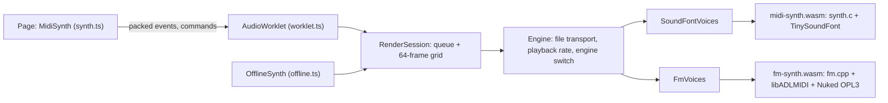

# Architecture

The package keeps transport, event timing and synthesis separate, so the offline tests exercise the scheduling code the browser runs.

| Owner | Responsibility | Reason |
| --- | --- | --- |
| `native/synth.c` | TinySoundFont behind one message entry, preset lookup and planar rendering | The per-sample work stays in C, and a standalone module needs no Emscripten glue. |
| `native/fm.cpp`, `native/adlmidi/` | libADLMIDI's real-time API behind the same kind of ABI; Nuked OPL3 with a block renderer | libADLMIDI maps General MIDI to OPL3 voices with the games' banks; the block renderer makes the chip affordable on an audio thread. |
| `src/synth.ts` | Browser lifecycle, validation, request acknowledgements and audio graph | Fetching the WASM and the SoundFont and compiling the module stay off the audio thread. |
| `src/worklet.ts` | Instantiate the first engine's precompiled module, compile a later engine's bytes, dispatch commands | The worklet owns its engines and releases them on disposal or failure. |
| `src/session.ts` | Split output blocks at event frames and at the 64-frame grid | Output does not depend on the caller's block size. |
| `src/queue.ts` | Fixed-capacity stable heap | Out-of-order submissions work without render-time sorting or object allocation. |
| `src/engine.ts` | File transport, playback rate, the active engine and the switch between engines | One boundary handles both browser and offline error paths. |
| `src/voices.ts` | Each module's ABI behind one `Voices` interface: messages, presets, planar PCM copy, output level | The transport and the scheduler do not know which engine plays. |
| `src/midifile.ts`, `src/parser.ts` | MIDI, RMI and MUS files; MIDI byte streams | Files become timed messages before playback, so the transport only indexes arrays. |
| `src/offline.ts`, `src/assets.ts` | Node, Bun and browser loading, streaming buffers and WAV encoding | Offline synthesis uses the same WASM and scheduler. |

## Why this design

TinySoundFont is one C header without dependencies. VERIFIED: the module built from it imports only `emscripten_notify_memory_growth` (`scripts/check-wasm.mjs`), so an AudioWorklet, Node and Bun instantiate the same 51 KB file with one import object. A JavaScript SoundFont player would run the per-voice sample loop as JavaScript on the audio thread. A FluidSynth build would add reverb, chorus and modulators, at the cost of a much larger code base to port and ship.

TimGM6mb is the bundled SoundFont because it covers General MIDI in 5.97 MB. A fuller set such as GeneralUser GS weighs about 30 MB, which every page would download before its first note. `loadSoundFont` takes any SF2 file for users who want one.

The renderer splits at every multiple of 64 output frames because TinySoundFont updates envelopes, filters and LFOs once per block of up to 64 frames from the start of each call. VERIFIED: `tests/core.test.ts` renders a score once in one piece and once in blocks of 64 to 4096 frames and compares the SHA-256 of both channels. Without the grid, the same score in other block sizes steps its envelopes at other frames, and a WAV export would differ from the live output.

The engine renders planar output (`TSF_STEREO_UNWEAVED`) and copies each channel in a plain loop over the module's memory. It makes a new view only when the memory grew, so a render quantum allocates nothing in JavaScript. With `maxVoices` preallocated, TinySoundFont allocates nothing while notes start either. Loading a SoundFont or a MIDI file allocates; do that between playback operations.

## Why two engines, and why the FM engine renders in blocks

A SoundFont plays recorded samples; the music of DOS games was written for the FM chip of AdLib and Sound Blaster cards and sounds as its composers heard it only there. libADLMIDI is the General MIDI driver for emulated OPL chips with the instrument banks of those games' sound drivers (79 embedded, `docs/music/banks.ini`). Its own sequencer is left out of the build; `src/midifile.ts` parses files for both engines, so seeking, the playback rate and the switch between engines work the same on both.

Nuked OPL3 emulates the chip cycle by cycle and is the costly part. Version 0.1.0 of this package spent 107 microseconds per 128-frame quantum on 4 chips. The block renderer (`native/adlmidi/src/chips/nuked_fast/nukedopl3_block.inc.c`) computes the same samples per operator over runs of samples instead of per sample over all operators: the clocks come first, each operator then runs a tight loop with its state in locals, and runs end where a buffered register write falls due. An operator that is fully released contributes only the sign of its waveform, which the renderer reads from a table. VERIFIED: `make bench` on an Apple M5 Max under Node 24.22.1, Doom's E1M1 with bank 16, the module alone: 20.9 against 36.4 microseconds per quantum on 1 chip and 32.1 against 148.0 on 4 chips (block renderer against the per-sample chip). Through the engine, 22.7 and 37.1 microseconds, 117 and 72 times faster than real time. WebAssembly tail calls measured no gain and `-O3` the same as `-O2`, so the build uses `-O2 -msimd128`.

VERIFIED: the block renderer produces the per-sample chip's output exactly. `scripts/rebuild-wasm.sh` fails otherwise: `tests/opl3-block-test.c` fuzzes register writes against both (4,000 rounds, 4,502,943 samples), and `scripts/fm-parity.mjs` renders game files through both modules (6,912,000 frames). Speed without this equality would be a different chip.

The engines' output levels differ by nature. VERIFIED: over eight game files of `docs/music`, TinySoundFont with TimGM6mb at 0 dB peaked above full scale on six (up to 2.16); `src/voices.ts` plays it at -6 dB and the FM engine at 2.5 times its output, which brings the median RMS ratio of the two to about 1.

## Compressed banks and file clocks

SoundFonts and WOPL banks ship Brotli-compressed, and the page's 135 MB SoundFont would not otherwise be served at all by hosts that cap a file at 100 MB. They unpack on the main thread (`src/assets.ts`) before they reach the worklet, because an audio thread that decodes 135 MB misses its quanta. Detection reads the format's signature rather than the file name, so bytes from a file picker or a fetch decide for themselves; bytes that are neither stay as they are, and the synthesizer's own check names the error. defuss-brotli's decoder loads only for a compressed file. VERIFIED: every compressed bank decompresses to its source's bytes; the 135 MB SoundFont took 1.46 s under Node.js and loaded in 1.6 s in Chromium from a local server. Sample data compresses poorly: quality 11 gave 76.8% for the OPL-3 SoundFont and 86.5% for TimGM6mb (`bun run compress`).

Loading reports its progress (`onProgress`). The decoder is `src/brotli.ts` over defuss-brotli's own WebAssembly rather than its `decompress()`, because that call reports nothing and holds the thread for the whole 1.5 s; the stepwise decoder reports every 4 MB of input and yields between steps. Downloads with a listener use XMLHttpRequest rather than a stream reader on `fetch`. VERIFIED: in a probe (`tmp/probe-stream-cancel.mjs`, throttled to 20 MB/s) Chromium reported 6 of 6 fetches read to their end through `getReader()` as canceled, although every byte arrived; `arrayBuffer()` and XMLHttpRequest gave 0 of 6.

`loadMidi`'s `tempo` scales the message times when the file loads, instead of riding on the playback rate. The transport, seeking and `status()` then count real seconds, and the rate stays the listener's.

## Operation

The browser uses MessagePort commands with request IDs. A command promise resolves after processing, not after audio playback. Initialization and command waits have bounded timers. Rendering does not await promises or block on other threads.

Events at the same frame keep insertion order. The heap rejects an overflowing batch before mutation. A late event runs at the next rendering opportunity and is counted. File messages carry frames computed at load, so playback indexes two typed arrays. Seeking resets every channel and replays each message before the target except note on, note off and poly pressure. Program changes, controllers and pitch bends are therefore in place when playback continues.

Pause freezes the file and the synthesizer and emits silence. Stop silences, rewinds the file, resets the channels and cancels scheduled events. At the end of a file, all notes are released, so their tails ring out. A SoundFont change stops the transport, because changing instruments under a sustained note would make the result ambiguous. An engine switch or an FM bank change does not: the engine resets the new synthesizer, replays the file's non-note messages up to the position and strikes the notes the file holds again, so a song plays on.

The first engine's module reaches the worklet compiled, in the processor's options. VERIFIED (Chromium 141): a `WebAssembly.Module` posted through the node's port never arrives, and the command times out; a later engine therefore travels as bytes and the worklet compiles them asynchronously, without blocking the audio thread. A rejected SoundFont keeps the loaded one, since `synth_load` parses the new file before it closes the old one.

The worklet passes the session `max(currentFrame, session frame)`, so the session's clock stays monotonic even if a browser reports a `currentFrame` below the frames already rendered. VERIFIED: a probe that counted such quanta found none in three Chromium runs.

## Security and privacy

The demo server binds to loopback and confines paths to its document root. User files stay in the browser. The package has no telemetry, credentials or remote processing service. File lengths, MIDI operands, channels, banks and queue capacity are validated before they reach the module. WASM isolates native memory from the host. Malformed input can still exhaust an instance or exceed a deadline, which is reported as a processor failure rather than hidden.

Operational commands and the browser asset layout are documented in [README.md](README.md). Benchmark evidence names its runtime and workload, so a throughput result is not taken for a browser deadline guarantee.
