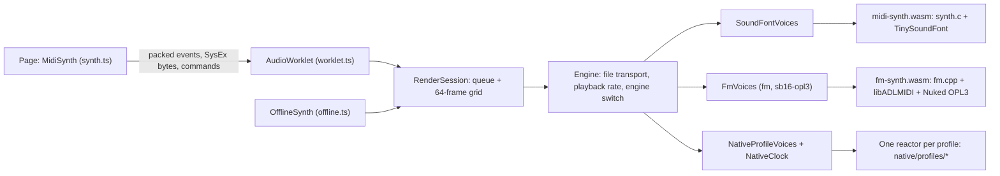

# Architecture

The package keeps transport, event timing and synthesis separate, so the offline tests exercise the scheduling code the browser runs.

| Owner | Responsibility | Reason |
| --- | --- | --- |
| `native/synth.c` | TinySoundFont behind one message entry, preset lookup and planar rendering | The per-sample work stays in C, and a standalone module needs no Emscripten glue. |
| `native/fm.cpp`, `native/adlmidi/` | libADLMIDI's real-time API behind the same kind of ABI; Nuked OPL3 with a block renderer | libADLMIDI maps General MIDI to OPL3 voices with the games' banks; the block renderer makes the chip affordable on an audio thread. |
| `native/profiles/` | The eight native cores and their adapters behind ABI 2 (`profile_pack.h`) | Each upstream emulator keeps its own structure, and the in-tree ECW and GF1 cores implement the ABI directly; an adapter is the only code that knows both the core and the host. |
| `src/synth.ts` | Browser lifecycle, validation, request acknowledgements and audio graph | Fetching the WASM, the SoundFont and the packs and compiling the modules stay off the audio thread. |
| `src/worklet.ts` | Instantiate the first engine's precompiled module, compile a later engine's bytes, dispatch commands | The worklet owns its engines and releases them on disposal or failure. |
| `src/session.ts` | Split output blocks at event frames and at the 64-frame grid | Output does not depend on the caller's block size. |
| `src/queue.ts` | Fixed-capacity stable heap and one SysEx byte store | Out-of-order submissions work without render-time sorting or object allocation. |
| `src/engine.ts` | File transport, playback rate, the active engine and the switch between engines | One boundary handles both browser and offline error paths. |
| `src/voices.ts`, `src/profile-voices.ts` | Each module's ABI behind one `Voices` interface: messages, SysEx, presets, planar PCM copy, output level | The transport and the scheduler do not know which engine plays. |
| `src/profiles.ts`, `src/profile-assets.ts` | The profile ids and descriptors; where a profile's module and pack come from, and the error when one is missing | A profile that cannot load says which file it lacks instead of falling back to another engine. |
| `src/profile-store.ts` | The user's profile files (pack, module) on a defuss-storage adapter; `openProfileStore` on the browser's origin private file system | It takes any defuss-storage adapter, so the same code runs on memory and Node files in the tests and on OPFS in a browser; a page's main thread reaches OPFS through the directory adapter, since the OPFS adapter needs a dedicated worker. |
| `src/profile-clock.ts` | `NativeClock`: a core's native rate to the output rate | One resampler serves all eight cores with the same partition behavior. |
| `src/midifile.ts`, `src/parser.ts` | MIDI, RMI and MUS files with their SysEx; MIDI byte streams | Files become timed messages before playback, so the transport only indexes arrays. |
| `src/offline.ts`, `src/assets.ts` | Node, Bun and browser loading, streaming buffers and WAV encoding | Offline synthesis uses the same WASM and scheduler. |

## Why this design

TinySoundFont is one C header without dependencies. VERIFIED: the module built from it imports only `emscripten_notify_memory_growth` (`scripts/check-wasm.mjs`), so an AudioWorklet, Node and Bun instantiate the same 51 KB file with one import object. A JavaScript SoundFont player would run the per-voice sample loop as JavaScript on the audio thread. A FluidSynth build would add reverb, chorus and modulators, at the cost of a much larger code base to port and ship.

TimGM6mb is the bundled SoundFont because it covers General MIDI in 5.97 MB. A fuller set such as GeneralUser GS weighs about 30 MB, which every page would download before its first note. `loadSoundFont` takes any SF2 file for users who want one.

The renderer splits at every multiple of 64 output frames because TinySoundFont updates envelopes, filters and LFOs once per block of up to 64 frames from the start of each call. VERIFIED: `tests/core.test.ts` renders a score once in one piece and once in blocks of 64 to 4096 frames and compares the SHA-256 of both channels. Without the grid, the same score in other block sizes steps its envelopes at other frames, and a WAV export would differ from the live output.

The engine renders planar output (`TSF_STEREO_UNWEAVED`) and copies each channel in a plain loop over the module's memory. It makes a new view only when the memory grew, so a render quantum allocates nothing in JavaScript. With `maxVoices` preallocated, TinySoundFont allocates nothing while notes start either. Loading a SoundFont or a MIDI file allocates; do that between playback operations.

## Why two engines, and why the FM engine renders in blocks

A SoundFont plays recorded samples; the music of DOS games was written for the FM chip of AdLib and Sound Blaster cards and sounds as its composers heard it only there. libADLMIDI is the General MIDI driver for emulated OPL chips with the instrument banks of those games' sound drivers (79 embedded, `docs/music/banks.ini`). Its own sequencer is left out of the build; `src/midifile.ts` parses files for both engines, so seeking, the playback rate and the switch between engines work the same on both.

Nuked OPL3 emulates the chip cycle by cycle and is the costly part. Version 0.1.0 of this package spent 107 microseconds per 128-frame quantum on 4 chips. The block renderer (`native/adlmidi/src/chips/nuked_fast/nukedopl3_block.inc.c`) computes the same samples per operator over runs of samples instead of per sample over all operators: the clocks come first, each operator then runs a tight loop with its state in locals, and runs end where a buffered register write falls due. An operator that is fully released contributes only the sign of its waveform, which the renderer reads from a table. VERIFIED: `make bench` (2026-11-25) on an Apple M5 Max under Node 24.22.1, Doom's E1M1 with bank 16, the module alone: 18.8 against 33.9 microseconds per quantum on 1 chip and 28.6 against 119.4 on 4 chips (block renderer against the per-sample chip). Through the engine, 21.4 and 34.6 microseconds, 125 and 77 times faster than real time. WebAssembly tail calls measured no gain and `-O3` the same as `-O2`, so the build uses `-O2 -msimd128`.

VERIFIED: the block renderer produces the per-sample chip's output exactly. `scripts/rebuild-wasm.sh` fails otherwise: `tests/opl3-block-test.c` fuzzes register writes against both (4,000 rounds, 4,502,943 samples), and `scripts/fm-parity.mjs` renders game files through both modules (6,912,000 frames). Speed without this equality would be a different chip.

The engines' output levels differ by nature. VERIFIED: over eight game files of `docs/music`, TinySoundFont with TimGM6mb at 0 dB peaked above full scale on six (up to 2.16); `src/voices.ts` plays it at -6 dB and the FM engine at 2.5 times its output, which brings the median RMS ratio of the two to about 1. `sb16-opl3` plays at the same 2.5 times: VERIFIED by `tests/fm.test.ts`, which finds its PCM equal to that of `fm` on one chip.

## Hardware profiles

A profile is an engine named after a card or module. `soundfont` and `sb16-opl3` run on the two engines above; the eight native profiles each run a core of their own, an emulator or a reconstruction. [HARDWARE_PROFILES.md](HARDWARE_PROFILES.md) lists the cores, their status and their limits; this section explains the shape they share.

**One ABI, one isolated reactor per core.** Every native core is its own WebAssembly reactor with the same eleven exports (`native/profiles/profile_pack.h`), so one host class, `NativeProfileVoices`, drives all eight, and the worklet instantiates each core once per synthesizer. Linking the cores into one module would put an unlicensed core (AWE32Emu's driver layer) beside GPL and LGPL code in one binary, make every page download all of them, and join cores that keep their state in static variables (`native/profiles/cqm.cpp`) into one memory. Separate modules keep each licence in its own file with its own notice, load only the profile a page uses, and give every instance its own memory. VERIFIED: a profile's module loads only on first use and once for concurrent calls (`tests/profiles.test.ts`), and `instantiateProfile` rejects a module that imports anything outside `env.emscripten_notify_memory_growth` and six WASI functions without file, environment or clock access (`tests/native-profile-abi.test.ts`). The ECW and GF1 cores, built with plain LLVM (`scripts/build-vintage-wasm.py`), import nothing.

**Packs instead of loose files.** A core receives its ROMs, wavesets or patches as one DSPK pack: numbered roles, lengths and raw bytes, copied into the core's memory before `profile_init`. One file means one fetch or one file picker, one structured-clone transfer into the audio thread, and one validation in the core, which checks the roles and each file (its size and CRC32, SHA-1 or format, by core) before anything plays. Loose files by name would need a file system or a per-profile name table in each core, and a missing or wrong ROM would surface inside an emulator instead of at init. The cores build with `-sFILESYSTEM=0`; AWE32Emu's sources open their three files through `fopen`, which `native/profiles/awe.cpp` answers from the pack's records, so the upstream files compile unmodified. VERIFIED: the Sound Canvas cores reject a missing role, a wrong size and a wrong CRC32 per image (`tests/sc55.test.ts`), and the AWE core 14 malformed packs (`tests/awe.test.ts`).

**SysEx keeps its original bytes.** The engines disagree on what a system exclusive message means. The MT-32 ignores the GM and GS resets and stores timbres from its own parameter writes; the Sound Canvas firmware parses GS; libADLMIDI sets its rhythm parts from GS; TinySoundFont knows only the resets and master volume. Mapping SysEx onto a few typed events would erase the MT-32's uploaded timbres and the GS part settings, so the host passes each message as it arrived and each engine applies what its hardware or driver knows. The host still recognizes the GM, GM2, GS and XG resets for its own state: they end the file's held notes. A seek or an engine switch resets the engine, then replays every SysEx of the file before the position in file order, so an MT-32 gets its timbres back. VERIFIED: `tests/core.test.ts` replays SysEx in file order on seek, `tests/fm.test.ts` finds a note on channel 1 after the GS drum-part message hash-equal to channel 10, and the MT-32 probe found a timbre SysEx changing the output and FFh erasing it again. The bytes wait in one store of the queue, indexed by offset and length; `pop` allocates nothing, and `NativeProfileVoices.sysex` nothing once the core's memory stops growing.

**`NativeClock` resamples every core.** Each core renders at its own rate, 19,293 to 66,206 Hz. `src/profile-clock.ts` converts that to the output rate by causal linear interpolation on an integer phase: per output frame the phase advances by the native rate, and each time it passes the output rate one native frame is consumed. Since the phase is an integer, the native frames consumed after n output frames are exactly floor(n times native over output), whatever the block sizes, so a WAV render and the live output match. Letting each core resample itself would give eight resamplers with eight partition behaviors; a band-limited resampler would alias less, at the cost of more latency and work per frame, and is not implemented. VERIFIED: after 2^21 frames at seven rate pairs the consumption is exact, with blocks of 61, 7, 128, 1 and 64 frames giving the same output as blocks of 128 (`tests/profiles.test.ts`); notes and SysEx at odd frames give the same PCM in blocks of 7, 61, 128, 1 and 300 frames as in one render, on the ECW and GF1 cores.

**The CQM reuses libADLMIDI.** `sb16-cqm` plays General MIDI through libADLMIDI with its 79 banks, on Nuked CQM instead of Nuked OPL3: the CQM takes the OPL3's register set, so replacing libADLMIDI's chip class is enough, and `setFmBank` and `loadFmBank` apply to it as to the FM engine. Its output is not halved: 86Box halves both its OPL3 and its CQM output, libADLMIDI neither, so the CQM's level against the OPL3 stays as in 86Box ([native/ARCH.md](native/ARCH.md#cqm-profile)).

## Compressed banks and file clocks

SoundFonts and WOPL banks ship Brotli-compressed, and the page's 135 MB SoundFont would not otherwise be served at all by hosts that cap a file at 100 MB. They unpack on the main thread (`src/assets.ts`) before they reach the worklet, because an audio thread that decodes 135 MB misses its quanta. Detection reads the format's signature rather than the file name, so bytes from a file picker or a fetch decide for themselves; bytes that are neither stay as they are, and the synthesizer's own check names the error. defuss-brotli's decoder loads only for a compressed file. VERIFIED: every compressed bank decompresses to its source's bytes; the 135 MB SoundFont took 1.46 s under Node.js and loaded in 1.6 s in Chromium from a local server. Sample data compresses poorly: quality 11 gave 76.8% for the OPL-3 SoundFont and 86.5% for TimGM6mb (`bun run compress`).

Loading reports its progress (`onProgress`). The decoder is `src/brotli.ts` over defuss-brotli's own WebAssembly rather than its `decompress()`, because that call reports nothing and holds the thread for the whole 1.5 s; the stepwise decoder reports every 4 MB of input and yields between steps. Downloads with a listener use XMLHttpRequest rather than a stream reader on `fetch`. VERIFIED: in a probe (`tmp/probe-stream-cancel.mjs`, throttled to 20 MB/s) Chromium reported 6 of 6 fetches read to their end through `getReader()` as canceled, although every byte arrived; `arrayBuffer()` and XMLHttpRequest gave 0 of 6.

`loadMidi`'s `tempo` scales the message times when the file loads, instead of riding on the playback rate. The transport, seeking and `status()` then count real seconds, and the rate stays the listener's.

## Operation

The browser uses MessagePort commands with request IDs. A command promise resolves after processing, not after audio playback. Initialization and command waits have bounded timers. Rendering does not await promises or block on other threads.

Events at the same frame keep insertion order. The heap rejects an overflowing batch before mutation, and a batch whose SysEx bytes would pass 16 MiB the same way. A late event runs at the next rendering opportunity and is counted. File messages carry frames computed at load, so playback indexes two typed arrays.

Seeking resets every channel and replays the file's state before the target (`chaseMask` in `src/engine.ts`): every SysEx and reset, every bank select, RPN, NRPN, data entry and channel mode message, whose effect depends on the messages around them, and of each channel only the last program, pitch bend, channel pressure and value of every other controller. A replay of every non-note message would give the same state, but the Sound Canvas cores take MIDI at the cable's 3,125 bytes per second into 16 KiB, so a file of many controller changes would delay the next notes by seconds or overflow the queue with changes that a later one replaces. VERIFIED: at mid-file over the 1,062 library files that parse, the replay is at most 5,215 bytes against 47,164 for every non-note message, and no file exceeds 16 KiB against 19 (a probe of `chaseMask`); `tests/core.test.ts` checks that a seek into a file of superseded controller changes sounds as one into the file of its final state.

Pause freezes the file and the synthesizer and emits silence. Stop silences, rewinds the file, resets the channels and cancels scheduled events. At the end of a file, all notes are released, so their tails ring out. A SoundFont change stops the transport, because changing instruments under a sustained note would make the result ambiguous. An engine switch or an FM bank change does not: the engine resets the new synthesizer, replays the file's state up to the position as a seek does and strikes the notes the file holds again, so a song plays on. A bank that the CQM core rejects restarts it on its old bank, and the same replay restores the playing file.

The first engine's module reaches the worklet compiled, in the processor's options. VERIFIED (Chromium 141): a `WebAssembly.Module` posted through the node's port never arrives, and the command times out; a later engine therefore travels as bytes and the worklet compiles them asynchronously, without blocking the audio thread. A module the worklet already holds goes by key alone, so `fm` and `sb16-opl3` compile `fm-synth.wasm` once. A rejected SoundFont keeps the loaded one, since `synth_load` parses the new file before it closes the old one.

A native core boots in `profile_init`, the Sound Canvas firmware for up to seconds, so the worklet makes voices only in its constructor and in the `addEngine` message, never in `process()`. A profile whose module or pack does not load rejects that command with an Error naming the profile and the file, and the engine that played plays on. Sources given to `useProfile` merge into those given at creation, so a page can create the synthesizer with a module and add the user's pack later. A message or SysEx that a core cannot take, such as a Sound Canvas MIDI IN queue that is full, counts in `dropped` (`status()`, `OfflineSynth.dropped`) instead of throwing in the render path, as a MIDI receiver drops what overflows it. Resets that a song sends still run on the audio thread at their frame; on the AWE cores such a reset rebuilds the synthesizer.

The worklet passes the session `max(currentFrame, session frame)`, so the session's clock stays monotonic even if a browser reports a `currentFrame` below the frames already rendered. VERIFIED: a probe that counted such quanta found none in three Chromium runs.

## Security and privacy

VERIFIED: The demo server binds to loopback and serves the static document root. Uploaded MIDI files, SoundFonts and WOPL banks stay in the browser. The gallery caches each selected core and bank in OPFS via defuss-storage. A browser can evict these files and a user can clear them through site settings. The package has no telemetry, credentials or remote processing service, and it processes no personal data. File lengths, a file's SysEx count (at most 65,536), MIDI operands, SysEx framing, channels, banks, pack sizes (at most 128 MiB) and queue capacity are validated before they reach a module. WASM isolates native memory from the host, and a native core sees only the host functions `instantiateProfile` grants: no file, network, environment or clock. Malformed input can still exhaust an instance or exceed a deadline, which is reported as a processor failure rather than hidden.

Packs hold copyrighted ROMs, wavesets and patches. The scripts write them to `profile-assets/`, which git ignores with every `*.dspack`, and the package and the site ship none; the AWE cores stay in `profile-assets/local-builds/` ([THIRD_PARTY.md](THIRD_PARTY.md)).

Operational commands and the browser asset layout are documented in [README.md](README.md). Benchmark evidence names its runtime and workload, so a throughput result is not taken for a browser deadline guarantee.
