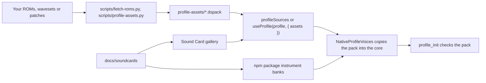

# Hardware profiles

The library supports Sound Blaster PCI 128, both SB16 chips, AWE32, AWE64 and Gravis UltraSound. The SoundFont and legacy multi-chip FM engines are also available.

## Supported profiles

Status is the state of 2026-11-25. VERIFIED: every module in this tree has the SHA-256 of the build the named test run used (`vendor/SHA256SUMS.json` against the unit reports in `../defuss-midi-synth.wt/<unit>/tmp/unit-report.md`).

| Profile | Core | Licence of the core | Status | Render cost per 128 frames, median |
| --- | --- | --- | --- | --- |
| `soundfont` | TinySoundFont 0.9 with TimGM6mb | MIT; TimGM6mb GPL-2.0 | Shipped; `make test` and Chromium | 7.5 µs (8 notes) to 94.0 µs (128 notes) |
| `sb16-opl3` | libADLMIDI 1.6.2 on one Nuked OPL3 fast chip (`fm-synth.wasm`) | GPL-3.0-or-later | Shipped; `make test` and Chromium | 21.0 to 21.4 µs |
| `sb16-cqm` | libADLMIDI 1.6.2 on Nuked CQM 0.9 beta (86Box `141ae59c`) | GPL-3.0-or-later; the chip LGPL-2.1-or-later | Shipped, 295,531 bytes; real core in `make test` and Chromium with a game bank | 74 µs at its native rate; 75 to 109 µs for a game file at 48 kHz |
| `awe32` | AWE32Emu `17b0578f` with 86Box's EMU8000 | EMU8000 GPL-2.0-or-later; driver layer unlicensed | Local build only, 296,501 bytes; tested with the GS ROM pack and with TimGM6mb in DRAM | 0.09 to 0.11 ms; p99 1.06 to 1.30 ms |
| `awe64` | The same core with the same 32 hardware voices | As `awe32` | As `awe32` | 0.09 to 0.13 ms; p99 1.08 to 1.34 ms |
| `sb-pci128` | ECW reconstruction, `native/profiles/pci128.c` | MIT | Shipped, 9,379 bytes; tested on the original EAPCI2M, 4M and 8M wavesets against ecw2sfz r3 (29 of 29) | 19.5 µs at 64 voices |
| `gus-gf1` | UltraMID reconstruction, `native/profiles/gus.c`, on GUSEMU32's GF1 mixer | MIT | Shipped, 12,381 bytes; tested with the original Gravis patch set (17 of 17) | 12.0 µs at 32 voices |

"Shipped" means the build copies the module to `dist/assets/profiles/` (`scripts/build.mjs`), so the npm package and the demo carry it. The SoundFont and OPL3 figures come from `make bench` (2026-11-25) and the SysEx unit's run of Doom's E1M1; the others from each unit's report, on the same Apple M5 Max under Node 24.22.1 while other units were building (load average 10 to 16). A 128-frame quantum lasts 2,667 µs at 48 kHz. These figures are Node WASM throughput, not browser deadlines.

`PROFILE_DESCRIPTORS` describes the core and asset requirements separately. AWE32 and AWE64 take a locally built core. All five cards have bundled instrument data.

## Packs

A DSPK pack contains a profile’s instrument data under numbered roles. The player cards load their bundled packs by default. Supply `profileSources[profile].assets` to override one.



DSPK v1 is the 4 bytes `DSPK`, then u32 little-endian version 1, model (the descriptor's `id`) and record count, then per record a u32 role, a u32 length and the raw bytes. A pack holds at most 128 MiB, no role twice, no empty record and no trailing bytes (`native/profiles/profile_pack.h`).

| Profile | Roles |
| --- | --- |
| `sb16-cqm` | No pack: libADLMIDI's embedded bank `fmBank`. Or one record: 32, a WOPL bank file; or 33, an embedded bank number (4 bytes, u32 LE). |
| `awe32`, `awe64` | 32 the bank (SBK, SF2 or SBAWE32.MDI); 3 the EMU8000 wave ROM, optional for a bank whose samples go to DRAM; 33 the configuration (u8 driver 0 Win95, 1 DOS, 2 SDK; u8 1 when the bank describes ROM samples; u32 LE DRAM in KiB, 512 to 28,672 in steps of 512); 34 an optional user bank. |
| `sb-pci128` | 32 an original ECW waveset, unmodified. |
| `gus-gf1` | 32 a GPAT bundle of indexed, unmodified GF1PATCH110 `.PAT` files (program 0 to 127, drums at 128 plus the note); 33 the driver data: active voices (14 to 32), then optional flags (1 keep 16-bit waves as UltraMID `-16`, 2 preload as `-c`, not both). |

The AWE manifests in `scripts/roms/` list ROM sizes and hashes for building custom packs.

```sh
python3 scripts/fetch-roms.py init                     # writes profile-assets/rom-sources.json: each set's files, shared files, a default
```

The wavesets and patches come from public driver archives, pinned by hash. `fetch-ecw` downloads EAPCI2M, 4M and 8M.ECW from EMAC's OEM driver folders and checks EMAC's sizes (2,259,067, 4,986,999 and 8,292,459 bytes) and pinned SHA-256s; flaterco.com lists 2,259,070 and 8,292,462 bytes, another revision, which `pack` imports. `fetch-gus` downloads ULTRAMID.INI and the patches its substitution table maps, from a pinned commit of Boxer's copy, each checked against the pinned darker-cpp manifest. `--memory` selects the table for 256 to 1024 KiB of card memory; the emulated DRAM is always 1 MiB.

```sh
python3 scripts/profile-assets.py fetch-ecw profile-assets/ecw                 # profile-assets/ecw/EAPCI8M.ECW.dspack and the others
python3 scripts/profile-assets.py fetch-gus profile-assets/gus --memory 1024 --voices 32   # profile-assets/gus/gus-gf1-1024k.dspack
python3 scripts/profile-assets.py pack-gus mapping.json gus.dspack --voices 32   # your own patches: {"0": "ACPIANO.PAT", ...}
```

The AWE core builds only on your machine, into `profile-assets/local-builds/`, and accepts a custom bank:

```sh
python3 scripts/build-native-profiles.py --local-awe awe32 awe64
python3 scripts/profile-assets.py pack-awe awe32 /path/to/SYNTHGM.SBK profile-assets/awe32.dspack --rom /path/to/awe32.raw --driver win95
python3 scripts/profile-assets.py pack-awe awe32 vendor/soundfonts/TimGM6mb.sf2 profile-assets/awe32-ram.dspack --ram 8192
```

`pack-awe` accepts a ROM identified by the AWE manifest or a custom dump with `--unverified-rom`. Supply the emulator module as `profileSources[profile].wasm`.

Each private asset set has its own test script, outside `make test`: `scripts/profile-ecw-test.mjs`, `scripts/profile-gf1-test.mjs` and `scripts/profile-awe-test.mjs`. Each header states its command.

## ABI 2

Each native core is a WebAssembly reactor without a start function. `src/profile-voices.ts` instantiates it with at most `env.emscripten_notify_memory_growth` and six WASI functions that expose no file, environment or clock; any other import rejects the module. The ECW and GF1 modules import nothing. Every core exports, per `native/profiles/profile_pack.h`:

| Export | Contract |
| --- | --- |
| `profile_abi()`, `profile_model()` | 2, and the descriptor's `id`; the host rejects a mismatch. |
| `profile_buffer(n)`, `profile_init(n)` | n writable bytes for the pack; 1 when the pack is valid, else 0. |
| `profile_rate()` | The core's native sample rate in Hz. |
| `profile_message(status, a, b)` | A channel message 80h to EFh, or FFh for the core's power-on state; 1 when taken. |
| `profile_sysex_buffer()`, `profile_sysex(n)` | Up to 65,536 bytes; 1 when the first n bytes are one message F0 to F7 that the core applied or ignored on purpose, 0 when malformed or when the core has no room. |
| `profile_render(n)` | n at most 128 planar float frames at the native rate, left then right. |
| `profile_voices()`, `profile_close()` | Sounding voices, or -1; frees the instance. |

A message or SysEx takes effect at the next rendered frame. The host passes SysEx as the original bytes. The CQM, AWE, ECW and GF1 cores reset on the GM, GM2, GS and XG resets (`profile_sysex_is_reset`). A message or SysEx a core refuses, counts as dropped instead of stopping the audio thread: `status().dropped` on `MidiSynth` and `OfflineSynth.dropped` report it for the active engine, and 0 on the engines without such an input (`src/engine.ts`, `src/profile-voices.ts`).

Native rates: `sb16-cqm` 49,716 Hz, `awe32` and `awe64` 44,100 Hz, `sb-pci128` 22,050 Hz, `gus-gf1` floor(617,400 / voices), 19,293 Hz at 32 voices to 44,100 Hz at 14. The host resamples each to the output rate ([ARCH.md](ARCH.md#hardware-profiles)).

## Fidelity limits

Each profile's limits come from its unit report. VERIFIED and HYPOTHESIS items name their evidence and falsifier there; the ones below decide what a listener hears.

### sb16-opl3 and soundfont

`sb16-opl3` is the `fm` engine on one chip: 18 two-operator voices, the `chips` option ignored, the same output level as `fm`. VERIFIED: its PCM equals that of `fm` with one chip (`tests/fm.test.ts`). It emulates the YMF262, not a card's analog stage. The SoundFont engine is sample playback without reverb, chorus, modulators or aftertouch, not a hardware emulation.

### sb16-cqm

- The core is Nuked CQM 0.9 beta, with a `FIXME` on its noise generator. UNKNOWN: bit-exactness against CT1978 silicon and the analog stage of the boards that carry it.
- VERIFIED: waveform 0 is a quadratic sine (third harmonic -28.6 dB, fifth -42.0 dB, against -75.1 and -81.1 dB on the OPL3), and the same notes leave 19.9% residual energy after the best gain and lag match, so the profile is not a scaled OPL3. `tests/cqm.test.ts` asserts both, within 1 dB of the parabola's 1/27 and above 1% residual; the figures are the unit's measurement.
- HYPOTHESIS: the CQM's 7 to 8 dB lower level and inverted polarity against the OPL3 belong to the chip, not the emulator. Falsifier: the same patch recorded on a CT1978 card and a YMF262 card through the same analog path.
- libADLMIDI drives it with DOS drivers' voice allocation and volume models for the OPL3, not a Creative driver written for the CQM.
- A reset makes a new player on a new chip: 192 allocations, at most 0.6 ms measured, on the audio thread when a song sends it.

### awe32, awe64

- The package consumer test plays each bundled AWE bank with the matching external WASM core.
- Output starts 980 frames (22.2 ms) late, upstream's block model; the host does not compensate it. The real AWE32 has no such lag.
- No SysEx is interpreted, as upstream; AWE NRPNs (filter, envelopes, effects) are not implemented upstream; resets rebuild the synth, about 20 ms on the audio thread with a 6 MB SF2.
- `awe64` differs from `awe32` only in its default DRAM (4,096 against 512 KiB); its software voices are not emulated.

### sb-pci128

The ECW core is a reconstruction from the wavesets, Engelmann's ECW specification 1.5 and ecw2sfz r3, not the Windows driver. VERIFIED on the three original wavesets: every reachable note's voices agree with ecw2sfz's decoding, every melodic program sounds, native and WASM output are bit-identical, and 9,000 mutated files ran clean under ASan and UBSan.

- HYPOTHESIS: the pitch offset of 5.19 semitones at 22,050 Hz puts these banks at concert pitch. It was fitted from the banks' own samples, so the tuning test checks consistency, not independent truth. Falsifier: a real AudioPCI recording of program 19, key 69, against 440 Hz.
- HYPOTHESIS: the layer delay is a big-endian word in milliseconds; little-endian gives delays of 51.2 s and 59.4 s, big-endian 200 ms and 1,000 ms. Falsifier: a hardware recording of program 123 whose second chirp comes about 200 ms after the onset.
- HYPOTHESIS: fixed-pitch patches play at key 60, and some 8M percussion is stored at half rate. Falsifier: the decay length of a hardware crash cymbal.
- UNKNOWN: the driver's output rate, envelope time curve, gain, velocity, volume and pan curves, vibrato depth, the loop shift of sample flags 129 and above, the wavetable envelope, voice stealing, GS variation fallback, reverb and chorus. The core plays 64 voices at 22,050 Hz with linear interpolation, the count the driver's INF file names.

### gus-gf1

The core does not execute UltraMID. It reconstructs UltraMID's driver from the Gravis SDK 2.10 documentation (ULTRADOC.TXT) and the usage text of ULTRAMID.EXE 1.12, which was read, never run. It plays the original patches through GUSEMU32's mixer, corrected to the SDK's ramp speed and constant-power pan. Patches load as 8-bit by default, into 1 MiB of emulated DRAM, with eviction of waves not sounding.

- VERIFIED with the Gravis set: tuning within 10 cents, the BRITEPNO decay within 0.01 dB of the SDK ramp, bend +201.7 cents at range 2, native and WASM output bit-identical, 100,000 mutated patches clean under ASan and UBSan.
- HYPOTHESIS: the 8-bit reduction keeps the high byte; the volume decode is QEMU's (dosbox-staging's differs by up to 0.5 dB); the pan table centers at 7; loop overshoot is kept; balance 0 is left. Falsifiers: a DRAM dump of UltraMID without `-16`, a level sweep, per-position levels and a short loop recorded on a GF1.
- UNKNOWN: how UltraMID maps velocity, CC7 and CC11, which voices it reserves for digital audio, when it loads patches and which it evicts, and how it handles SysEx.
- Uploads of patches run inside `profile_message` on the audio thread: at most 64 KB of conversion per wave, 0.35 ms for the whole mapped set.

### Every native profile

The host's linear resampler is not band-limited, and no profile models a card's analog output. UNKNOWN: whether any profile sounds like its hardware, since no hardware recording has been compared; and how firmware boot or resets on the audio thread behave in an AudioWorklet under load.
